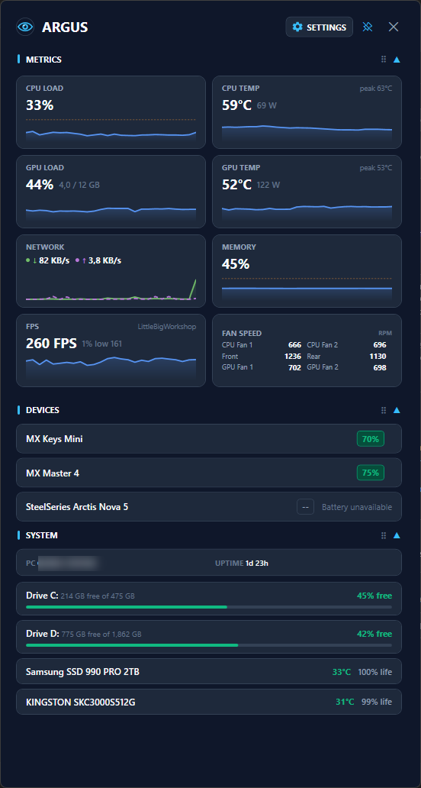
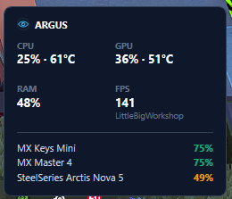

<h1>
  
  Argus
</h1>

**Argus** is a modern, lightweight Windows system monitoring dashboard that sits quietly in your notification area (system tray). Named after the all-seeing hundred-eyed giant of Greek mythology, Argus provides real-time hardware telemetry, Grafana-style time-series trend graphs, storage health, and peripheral battery status—all packed into a sleek dark UI.

<p align="center">
  
  &nbsp;&nbsp;
  
</p>
<p align="center"><em>The dashboard (pinned on a second monitor) and the summary shown when hovering the tray icon.</em></p>

---

## ✨ Features

- **📊 Real-Time Metric Telemetry (1-Second Refresh)**:
  - **GPU**: Temperature, load (`%`), power draw (`W`) and dedicated VRAM (`GB used / total`) of the dedicated GPU (on systems with an integrated and a dedicated GPU, the dedicated one is shown).
  - **CPU**: Temperature (`°C`), package power draw (`W`) and total CPU load (`%`).
  - **Session peaks**: the highest CPU and GPU temperature since Argus started.
  - **Memory**: System RAM utilization (`%`) and physical memory breakdown (`GB used / total`).
  - **Network**: Independent Download (`↓`) and Upload (`↑`) rates with automatic peak bandwidth scaling and network adapter link capacity (e.g. `1 Gbps`, `2.5 Gbps`).
  - **FPS**: Live framerate and **1% lows** of the app in the foreground (or the app behind the dashboard while you look at it), measured with Intel's PresentMon, which is bundled with Argus. Apps averaging under 10 FPS (editors, chat apps, an idle browser) are ignored; the measured app's name is shown on the card.
  - **Fan Speed**: RPM tracking across all active system, case, and GPU cooling fans, with custom fan names (motherboard fans first, then GPU fans, each sorted by name).

- **📈 Grafana-Style Time-Series Graphs**:
  - Vector sparklines for every metric, including FPS, with a selectable time span (30 s, 2, 5 or 10 minutes).
  - Temperature graphs auto-scale to recent readings; a dashed line marks the warning threshold.
  - **Smart Threshold Alerts**: Colors shift from neutral Grafana Blue (`#5794F2`) to Amber (`#FF9830`) on warning thresholds and Red (`#F2495C`) on critical loads, based on a 5-second average so brief spikes don't trigger them.
  - **Temperature notifications**: a Windows notification when the CPU or GPU stays at or above its critical temperature for 30 seconds. CPU and GPU warning/critical temperatures are configurable in Settings.

- **🖐️ Full Drag & Drop Customization**:
  - Drag and drop **section blocks** (`METRICS`, `SYSTEM`, `DEVICES`) to reorder the main view.
  - Drag and drop **individual metric cards** across the 2-column grid to create your preferred layout.
  - Click section headers to collapse or expand blocks on the fly.
  - Custom section and card orders are automatically saved to `%LOCALAPPDATA%\Argus\settings.json`.

- **💾 System & Storage Monitoring**:
  - Live PC uptime and machine info.
  - Free space per drive with a usage bar.
  - Physical disk health: temperature and remaining life from SMART (NVMe and SATA drives).

- **🔋 Peripheral Battery Status**:
  - Battery levels for connected Bluetooth devices and supported USB headsets (currently the SteelSeries Arctis Nova 5).
  - Color-coded battery badges (Green `> 50%`, Amber `20–50%`, Red `< 20%`).

- **🪟 Popup or Pinned Window**:
  - Opens as a popup next to the tray that hides when you click elsewhere.
  - Pin it (or drag it by its header) to keep it open anywhere, e.g. on a second monitor; size and position are remembered, and it can stay on top of other windows.
  - Hovering the tray icon shows a compact summary: CPU/GPU load and temperature, RAM, FPS and battery levels.

- **🚀 Optional Windows Auto-Start**:
  - Toggle "Start Argus on Windows startup" in Settings. When Argus runs as administrator this registers a Task Scheduler task, so it starts with full sensor access at sign-in without a UAC prompt.

- **🔒 100% Local & Privacy-Focused**:
  - Zero external network requests, zero telemetry tracking, and zero cloud dependencies.
  - Diagnostics are written only to a local log (`%LOCALAPPDATA%\Argus\argus.log`, "Open log folder" in Settings).
  - Runs completely offline on your local machine.

---

## 🛠️ System Requirements

| Requirement | Details |
| :--- | :--- |
| **Operating System** | Windows 10 / Windows 11 (64-bit) |
| **Users (Standalone Executable)** | **No runtime installation needed!** Download and run `Argus.exe`. |
| **SDK (Developers)** | [.NET 8.0 SDK](https://dotnet.microsoft.com/download/dotnet/8.0) |
| **Permissions** | Runs as a standard user. CPU temperature and motherboard fans need Argus to run as administrator (the dashboard offers "Restart as admin") and the free [PawnIO](https://pawnio.eu/) driver. Vendor utilities that access the same sensor chip (e.g. ASUS Armoury Crate) can make motherboard fans unavailable. |

---

## 🚀 Download & Installation

### Option 1: Standalone Single-File Executable (Recommended for Users)
1. Download `Argus.exe` from the latest [GitHub Releases](https://github.com/kristianmatreolsen/Argus/releases).
2. Double-click `Argus.exe` to run. **No installation or .NET runtime setup required!**

---

### Option 2: Building from Source (Developers)

1. Clone the repository:
   ```powershell
   git clone https://github.com/kristianmatreolsen/Argus.git
   cd Argus
   ```

2. Restore dependencies and run the application:
   ```powershell
   dotnet restore
   dotnet run --project src/Argus/Argus.csproj
   ```

3. Build a standalone `.exe` locally:
   ```powershell
   dotnet publish src/Argus/Argus.csproj -c Release -r win-x64 --self-contained true -p:PublishSingleFile=true -p:EnableCompressionInSingleFile=true -o publish/
   ```
   *The output single-file `Argus.exe` will be located inside the `publish/` directory.*

   The build downloads the pinned PresentMon release from GitHub and checks its SHA-256 before embedding it. Without internet access the build still succeeds (with a warning), but FPS then needs an installed PresentMon (AMD Software, RivaTuner Statistics Server or NVIDIA FrameView).

---

## 📖 Usage Guide

- **Accessing the Dashboard**: Click the Argus eye icon in the notification area to open or close the dashboard. Click the pin button (or drag the header) to keep it open; press Esc or click elsewhere to hide the popup.
- **Settings**: Click the **SETTINGS** button on the dashboard, or right-click the tray icon and select **Settings**.
  - Toggle visibility for metric cards, system information, connected devices, and tray battery details.
  - Give fans custom names (e.g. `CPU 1`, `Front`); each fan's live RPM is shown to help match it to its motherboard header.
  - Choose the graph time span (30 s, 2, 5 or 10 minutes) and whether the pinned dashboard stays on top of other windows.
  - Set CPU and GPU warning/critical temperatures and turn temperature notifications on or off.
  - Enable **Start Argus on Windows startup**. Run Argus as administrator first so it starts with full sensor access; without administrator rights it starts at sign-in without CPU temperature and fan readings. Because the logon task starts `Argus.exe` with administrator rights, keep it in a folder only administrators can change (e.g. `C:\Program Files\Argus`), not in Downloads.
  - The footer shows the version and an **Open log folder** link.
- **Reordering Elements**:
  - Drag a **section header** (`METRICS`, `SYSTEM`, `DEVICES`) up or down to reorder sections; click it to collapse or expand the section.
  - Drag a **metric card** onto another card to move it to that position.
- **System Tray Hover**: Hovering over the tray icon shows CPU and GPU load and temperature, RAM, FPS while a game is running, and device battery levels. Metrics the hardware does not expose are shown as `--`.

---

## 🧰 Troubleshooting

| Symptom | Cause and fix |
| :--- | :--- |
| CPU temperature or motherboard fans show `--` or are missing | They need administrator rights and the [PawnIO](https://pawnio.eu/) driver. The dashboard shows a banner with **Restart as admin** or **Get PawnIO**. |
| Motherboard fans disappear after installing or opening vendor software | Tools that control the same sensor chip (e.g. ASUS Armoury Crate, Fan Xpert, RGB/lighting services) can block readings while they run. Close or uninstall them, or set fan curves in the BIOS instead. |
| Fans appear as `Fan #2`, `Fan #3`, … | Your board's header names are not known to the sensor library. Rename them in **Settings → Fan names**; the live RPM helps match them with the BIOS fan page. |
| FPS shows "No game detected" while a game runs | FPS follows the app in the foreground (or the one behind the dashboard). Click into the game once, then open the dashboard. |
| FPS shows "FPS unavailable" | PresentMon could not start. On standard (non-administrator) Windows accounts this can need administrator rights; the log shows the reason. |
| Something else looks wrong | Open the log via **Settings → Open log folder** (`%LOCALAPPDATA%\Argus\argus.log`). It lists the detected hardware, the PresentMon in use and any sensor errors. |

---

## 🔒 Security & Privacy Statement

Argus was built with security and transparency in mind:

1. **No External Network Calls**: Argus does not communicate with external servers, telemetry services, or remote APIs. The only link it can open is the PawnIO website, in your browser, when you click **Get PawnIO**.
2. **Local Settings Storage**: User preferences are stored exclusively in your local Windows user profile directory (`%LOCALAPPDATA%\Argus\settings.json`).
3. **Open Source Dependencies**:
   - `LibreHardwareMonitorLib`: Open-source hardware sensor library.
   - `Hardcodet.NotifyIcon.Wpf`: WPF system tray wrapper.
   - `HidSharp`: Open-source HID device communication library.
   - `PresentMon` (Intel, MIT): bundled for FPS measurement. The build downloads a pinned release and verifies its SHA-256; at runtime Argus extracts it (to `%ProgramFiles%\Argus\PresentMon` when running as administrator, otherwise `%LOCALAPPDATA%\Argus\PresentMon`), checks the hash again and keeps the file locked while it runs.

   See [THIRD-PARTY-NOTICES.md](THIRD-PARTY-NOTICES.md) for licenses.

---

## ⚠️ Known Limitations

- Only tested so far on one Windows 11 desktop (AMD Ryzen, NVIDIA GPU, ASUS board). Intel CPUs, AMD GPUs, laptops with hybrid graphics and Windows 10 should work but are untested.
- Reading the dedicated GPU every second may keep it from going to sleep on some hybrid-graphics laptops, which can cost battery life.
- `Argus.exe` is a single-file app: .NET unpacks a few native WPF libraries to `%TEMP%\.net` on first start. When Argus runs as administrator, those files live in a folder your user account can write to.

---

## 🏷️ Releasing

Pushing a version tag builds and publishes a release with `Argus.exe` and `THIRD-PARTY-NOTICES.md`:

```powershell
git tag v1.2.0
git push origin v1.2.0
```

The version shown in Settings comes from the tag; builds from `main` without a tag are marked `0.0.0-ci.<run>`, local builds `0.0.0-dev`.

---

## 📄 License

Distributed under the MIT License.
